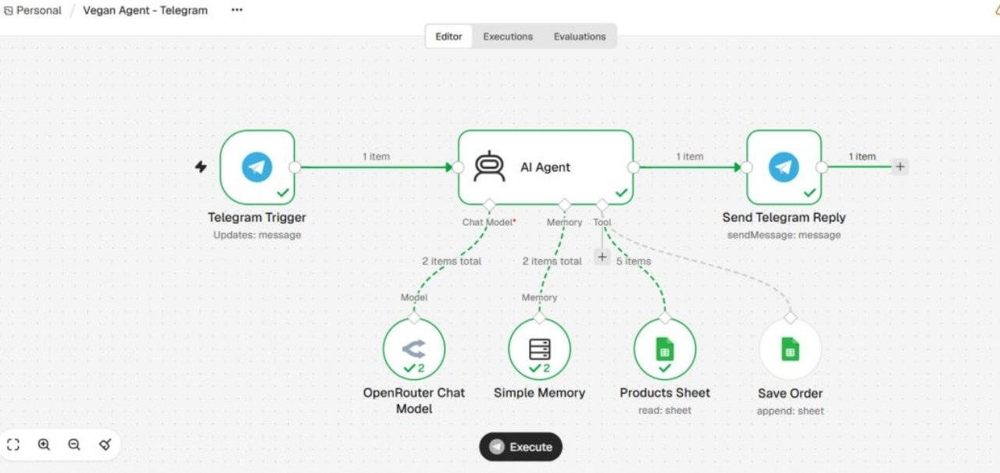
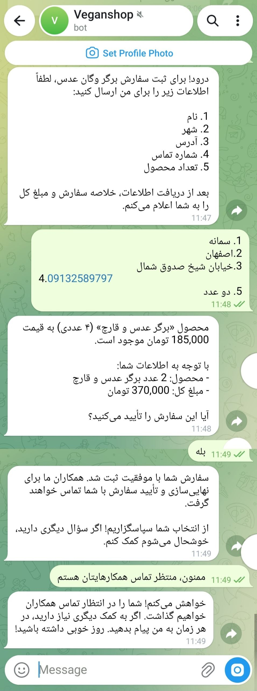
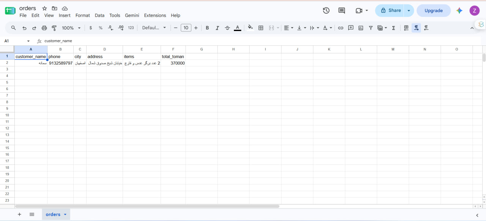

<div dir="rtl">

# دستیار فروش هوشمند فروشگاه وگان (n8n)

**فارسی** | [English](README.md)

یک ایجنت هوش مصنوعی برای فروش و پشتیبانی یک فروشگاه فرضی محصولات وگان («سبزینه»)، ساخته‌شده با **n8n**، **OpenRouter** و **Google Sheets** و متصل به **تلگرام**.

> این یک پروژه آموزشی و نمونه‌کار است. شرکت، محصولات، قیمت‌ها و سفارش‌های نمایشی فرضی هستند.



## قابلیت‌ها

- پاسخ به سؤال‌های مشتری به فارسی درباره محصولات، قیمت، موجودی و آلرژن‌ها.
- خواندن اطلاعات محصولات از یک Google Sheet زنده؛ با ویرایش شیت، ایجنت بدون تغییر دیگری به‌روز می‌شود.
- جمع‌آوری اطلاعات سفارش (نام، تلفن، شهر، آدرس، محصولات)، نمایش خلاصه و مبلغ کل، و **ثبت سفارش در شیت دوم فقط پس از تأیید صریح مشتری**.
- حافظه گفتگوی جدا برای هر چت تلگرام.
- حدس نزدن: هر چیزی که در پرامپت یا شیت نباشد به پشتیبانی انسانی ارجاع داده می‌شود.

## نمونه اجرا

| گفتگو در تلگرام | سفارش ثبت‌شده |
|---|---|
|  |  |

مشتری درباره یک محصول می‌پرسد، اطلاعات سفارش را می‌دهد و تأیید می‌کند؛ ایجنت یک ردیف به شیت `orders` اضافه می‌کند.

## معماری

</div>

```
Telegram Trigger ─► AI Agent ─► Send Telegram Reply
                      │
                      ├─ Chat Model   (OpenRouter)
                      ├─ Memory       (Window Buffer, per chat id)
                      ├─ Tool: Products Sheet  (Google Sheets, read)
                      └─ Tool: Save Order      (Google Sheets, append)
```

<div dir="rtl">

فایل `workflows/chat.json` به‌جای تلگرام از Chat Trigger خود n8n استفاده می‌کند و برای تست سریع است.

## ساختار پوشه

| مسیر | کاربرد |
|---|---|
| `workflows/telegram.json` | ورک‌فلو اصلی (تلگرام) |
| `workflows/chat.json` | ورک‌فلو تست (چت داخل n8n) |
| `data/products.csv` | نمونه جدول محصولات |
| `data/orders.csv` | ردیف عنوان ستون‌های شیت سفارش‌ها |
| `docs/` | اسکرین‌شات‌ها |

## راه‌اندازی

1. **شیت‌ها:** در Google Sheets دو فایل `products` و `orders` بسازید و CSV مربوط به هرکدام را از پوشه `data/` ایمپورت کنید. نام ستون‌های `orders` را تغییر ندهید.
2. **OpenRouter:** از [openrouter.ai](https://openrouter.ai) یک API Key بگیرید.
3. **ایمپورت:** در n8n: *Workflows ← ⋯ ← Import from file* و یکی از فایل‌های `workflows/` را انتخاب کنید.
4. **Credential ها:** این اطلاعات داخل JSON نیست و باید مال خودتان را وصل کنید:
   - گره *OpenRouter Chat Model*: کلید OpenRouter
   - گره‌های *Products Sheet* و *Save Order*: حساب Google و انتخاب فایل `products` / `orders`
   - گره‌های *Telegram Trigger* و *Send Telegram Reply*: توکن ربات از @BotFather
5. **تنظیم ستون‌های Save Order:** گره *Save Order* را باز کنید، *Mapping Column Mode* را روی *Map Each Column Manually* بگذارید، دکمه refresh کنار *Columns* را بزنید و برای هر شش ستون روی دکمه ✨ (*Let the model specify this parameter*) کلیک کنید. ممکن است این تنظیم هنگام ایمپورت منتقل نشود و بدون آن چیزی در شیت نوشته نمی‌شود.
6. **اجرا:** اول با ورک‌فلو چت تست کنید. برای تلگرام ورک‌فلو را **Publish** کنید (Telegram Trigger به آدرس HTTPS عمومی نیاز دارد، مثلاً n8n Cloud) و به ربات پیام بدهید. وقتی ورک‌فلو Published است دکمه *Execute* را نزنید.

## شخصی‌سازی

شخصیت ایجنت، قوانین، ارسال و بازگشت کالا همه در **AI Agent ← Options ← System Message** هستند. با عوض کردن آن‌ها و شیت‌ها می‌توانید ایجنت را برای کسب‌وکار دیگری بسازید.

## عیب‌یابی

- **ربات می‌گوید سفارش ثبت شد ولی شیت خالی است.** تب *Executions* را باز کنید، اجرا را باز کنید و ببینید *Save Order* زیر *AI Agent* در Logs هست یا نه.
  - اگر نیست: مدل ابزار را صدا نزده. از مدلی استفاده کنید که Tool Calling را قابل‌اعتماد انجام می‌دهد و این قانون را به System Message اضافه کنید: *«فقط وقتی ابزار Save Order نتیجه موفق برگرداند بگو سفارش ثبت شد. اگر صدا زده نشد یا خطا داد، بگو مشکلی پیش آمده و شماره پشتیبانی را بده.»*
  - اگر قرمز است: Credential، Document، Sheet و تنظیم ستون‌ها (مرحله ۵) را چک کنید.
- **ربات فقط وقتی Execute می‌زنم جواب می‌دهد.** ورک‌فلو Publish نشده است؛ دکمه *Publish* را بزنید.

## محدودیت‌ها

- سفارش‌ها فقط به یک شیت اضافه می‌شوند؛ پرداخت، کسر موجودی و تشخیص سفارش تکراری وجود ندارد.
- دقت موجودی به‌روز بودن شیت بستگی دارد.
- حافظه گفتگو یک پنجره کوتاه است، نه ذخیره بلندمدت.
- قابل‌اعتماد بودن Tool Calling به مدل انتخابی بستگی دارد.

## ایده‌های بعدی

- افزودن ابزار HTTP Request برای قیمت زنده یا پیگیری سفارش.
- ارسال اعلان به تلگرام کارمندان هنگام ثبت سفارش جدید.
- ساخت مجموعه‌ای از سؤال‌های نمونه در بخش *Evaluations* برای سنجش کیفیت پاسخ‌ها.

## ابزارها

n8n · OpenRouter · Google Sheets · Telegram Bot API

</div>
