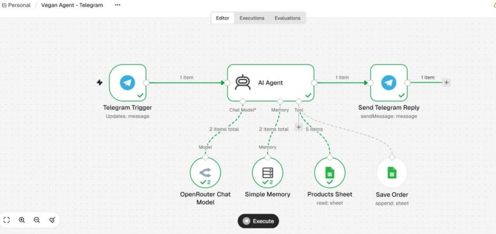
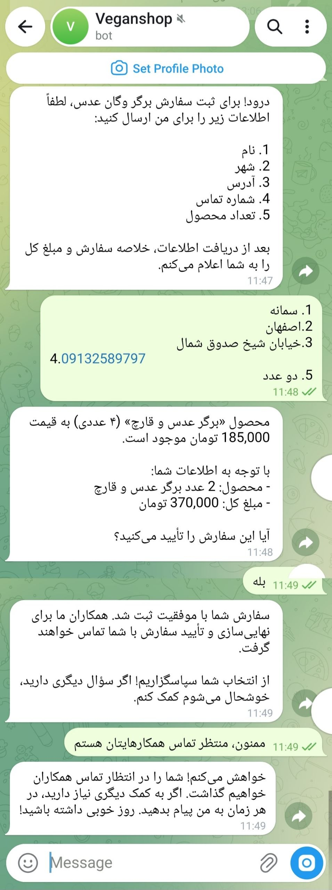
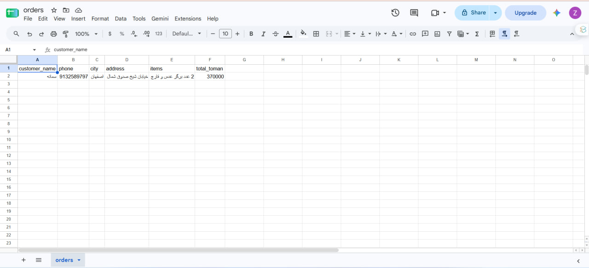

# Vegan Shop AI Sales Assistant (n8n)

[فارسی](README.fa.md) | **English**

An AI sales and support agent for a fictional vegan food shop ("Sabzineh"), built with **n8n**, **OpenRouter** and **Google Sheets**, and connected to **Telegram**.

> Educational portfolio project. The company, products, prices and demo orders are fictional.



## What it does

- Answers customer questions in Persian about products, prices, stock and allergens.
- Reads live product data from a Google Sheet, so editing the sheet updates the agent with no redeploy.
- Collects order details (name, phone, city, address, items), shows a summary and total, and **saves the order to a second sheet only after the customer explicitly confirms**.
- Keeps separate conversation memory per Telegram chat.
- Does not guess: anything outside the system prompt or the sheet is handed off to human support.

## Demo

| Telegram conversation | Saved order |
|---|---|
|  |  |

The customer asks about a product, gives order details, confirms, and the agent appends a row to the `orders` sheet.

## Architecture

```
Telegram Trigger ─► AI Agent ─► Send Telegram Reply
                      │
                      ├─ Chat Model   (OpenRouter)
                      ├─ Memory       (Window Buffer, per chat id)
                      ├─ Tool: Products Sheet  (Google Sheets, read)
                      └─ Tool: Save Order      (Google Sheets, append)
```

`workflows/chat.json` uses the n8n Chat Trigger instead of Telegram, for quick testing inside n8n.

## Repository layout

| Path | Purpose |
|---|---|
| `workflows/telegram.json` | Production workflow (Telegram) |
| `workflows/chat.json` | Test workflow (built-in chat) |
| `data/products.csv` | Sample product sheet |
| `data/orders.csv` | Header row for the orders sheet |
| `docs/` | Screenshots |

## Setup

1. **Sheets.** In Google Sheets create two spreadsheets, `products` and `orders`, and import the matching CSV from `data/`. Do not rename the `orders` columns.
2. **OpenRouter.** Create an API key at [openrouter.ai](https://openrouter.ai).
3. **Import.** In n8n: *Workflows → ⋯ → Import from file*, choose a file from `workflows/`.
4. **Credentials.** Credentials are not included in the JSON. Attach your own to:
   - *OpenRouter Chat Model*: OpenRouter API key
   - *Products Sheet* and *Save Order*: Google account, then pick the `products` / `orders` spreadsheets
   - *Telegram Trigger* and *Send Telegram Reply*: bot token from @BotFather
5. **Configure the Save Order columns.** Open the *Save Order* node, set *Mapping Column Mode* to *Map Each Column Manually*, click refresh next to *Columns*, and for each of the six columns click the ✨ button (*Let the model specify this parameter*). Imported workflows may not carry this mapping over, and without it nothing is written to the sheet.
6. **Run.** Test with the chat workflow first. For Telegram, **Publish** the workflow (Telegram Trigger needs a public HTTPS n8n URL, e.g. n8n Cloud) and message your bot. Do not press *Execute* while it is published.

## Customizing

The persona, rules, shipping and return policy all live in **AI Agent → Options → System Message**. Replace them and the sheets to adapt this to another business.

## Troubleshooting

- **The bot says the order was saved, but the sheet is empty.** Open *Executions*, open the run, and check whether *Save Order* appears under *AI Agent* in the logs.
  - Not there: the model skipped the tool. Use a model that handles tool calling reliably, and add a rule to the system prompt: *"Only say the order is saved after the Save Order tool returns success. If it was not called or failed, say there was a problem and give the support phone number."*
  - Red / error: check the node's credential, document, sheet and the column mapping from step 5.
- **Telegram does not answer unless I press Execute.** The workflow is not published. Click *Publish*.

## Limitations

- Orders are appended to a sheet; there is no payment, inventory decrement or duplicate-order check.
- Product stock is only as accurate as the sheet.
- Conversation memory is a short window, not long-term storage.
- Tool-calling reliability depends on the chosen model.

## Possible next steps

- Add an HTTP Request tool for live prices or order tracking.
- Notify staff on Telegram when a new order is saved.
- Add an evaluation set of sample questions in n8n *Evaluations*.

## Stack

n8n · OpenRouter · Google Sheets · Telegram Bot API
